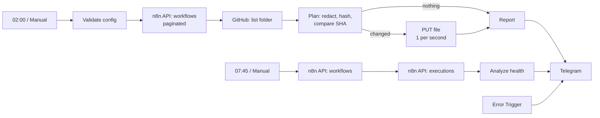

# n8n Ops Toolkit: GitHub Backup with Secret Redaction + Daily Health Report

> Keep a self-hosted n8n instance safe in production. Every workflow is backed up to a private GitHub repo (secrets redacted, unchanged files skipped), and a daily Telegram digest tells you what is failing, exposed or forgotten.

## What it does

| Job | Behavior |
|---|---|
| **Backup** (daily 02:00) | Reads all workflows through the n8n API and writes one JSON file per workflow (`<id>-<name>.json`) to a GitHub folder. |
| **Redaction** | API keys, tokens, passwords, private keys and well-known token formats (GitHub, AWS, Slack, Stripe, Google, Telegram, JWT, `sk-...`) are replaced with `[REDACTED]`. Expressions (`={{ ... }}`) and placeholders are left alone. |
| **No pinned data** | `pinData` and `staticData` are dropped because they can contain customer data. |
| **Change detection** | The git blob SHA-1 of each file is computed locally and compared with the SHA GitHub reports. Unchanged workflows cost zero write requests, and the repo history only shows real changes. |
| **Orphans** | Files whose workflow was deleted in n8n are reported, never deleted. Renames keep the old file and say so. |
| **Health report** (daily 07:45) | Workflows (active/inactive), executions and failures in the last 24 h, top failing workflows, runs longer than 10 min, active webhooks **without authentication**, hardcoded secrets, active workflows with **no Error Workflow**, and active workflows that have not run in 7+ days. |
| **Error alerts** | An Error Trigger flow sends a Telegram message when any workflow set to use this one fails. |

The backup message is silent when nothing changed.

## Architecture

## Setup

1. In n8n open **Settings > n8n API** and create an API key.
2. Create credentials:

   | Name | Type | Header name | Value |
   |---|---|---|---|
   | n8n API key | Header Auth | `X-N8N-API-KEY` | your key |
   | GitHub token | Header Auth | `Authorization` | `Bearer <token>` |
   | Telegram account | Telegram API | | bot token |

   Use a **fine-grained GitHub token limited to one private repository** with *Contents: read and write* and nothing else.
3. Import `workflows/n8n_ops_toolkit.json`.
4. Edit **Backup Config** (owner, repo, branch, folder, API URL) and **Health Config** (API URL). Replace `REPLACE_WITH_ALERT_CHAT_ID` in the three Telegram nodes and the `REPLACE_ID` credential slots.
5. Set this workflow as its own **Error Workflow** (and on the workflows you want monitored).
6. Run **Manual Backup**, check the repo, run **Manual Health**, then activate.

The API URL is the one your n8n instance uses to reach itself, for example `http://localhost:5678/api/v1`. On n8n Cloud use `https://<your-subdomain>.app.n8n.cloud/api/v1`.

## Use a private repository

Redaction is pattern based and cannot guarantee that every secret is caught. A secret in an unusual field or an unknown format will be committed. Keep the repo private, and treat the "Secrets found" warning as a task: move them into credentials or environment variables and rotate them.

## Restoring

Import a file with **Import from File** in n8n. Redacted values show `[REDACTED]`; re-enter them (or better, reference credentials). Credentials themselves are never exported.

## Configuration

| Setting | Where | Default |
|---|---|---|
| Backup schedule | *Daily Backup Schedule* | `0 2 * * *` |
| Health schedule | *Daily Health Schedule* | `45 7 * * *` |
| Long run threshold | `LONG_RUN_MS` in *Analyze Health* | 10 min |
| Execution history read | *Fetch Executions* (`maxRequests` 4 x 250) | last 1000 |
| Write pace | *Write File* batching | 1 per second |

## Testing

161 checks run against the Code nodes with mocked n8n inputs:

- The pure-JS SHA-1 matches Node's `crypto` for 15 input sizes (including padding boundaries), and the blob id matches `git hash-object` byte for byte (including UTF-8 and emoji).
- Redaction: key names (camel, snake, hyphen), name/value pairs, token formats, placeholders and expressions, private keys, and no false positives (`tokens: 5`, `author`).
- Planner: create, update with SHA, unchanged skip, rename, orphans, partial-read safety, 403 vs 404, unsafe ids, single-line commit messages.
- Config validation (path traversal, bad URLs), report escaping and length caps, health analysis, workflow structure.

Not verified: a live n8n instance, the real GitHub API and Telegram. The pagination parameters of the n8n API node (`cursor` / `nextCursor`) follow the public API documentation; if your version differs, the first run will show it, and *Collect Workflows* reports a partial read instead of failing silently.

## Troubleshooting

| Problem | Fix |
|---|---|
| "Could not read workflows" | Wrong API URL or key. Open the URL in a browser: `/api/v1/workflows` should answer 401 without a key. |
| "Could not list the backup folder" | Token lacks access to the repo, or the repo/branch name is wrong. A missing folder is fine and is created. |
| Every file is rewritten each run | Something in the workflow changes on each read. Check the diff in GitHub. |
| 422 on write | The file changed on GitHub between listing and writing. The next run fixes it. |

## Limitations

- Credentials, variables, tags and folders are not backed up, only workflows.
- Redaction is heuristic (see above).
- Workflow files with the same id and a different name leave the old file behind (reported).
- Health stats use the latest 1000 executions only.

## Roadmap

- Backup credentials metadata (names, types, never values)
- Restore workflow from Telegram
- Prometheus metrics endpoint
- Per-workflow SLA thresholds

## License

MIT. Add a `LICENSE` file to your repository.
